<!-- Profile README for github.com/itsmemohsinali -->

<picture>
  <source media="(prefers-color-scheme: dark)" srcset="assets/header-dark.svg" />
  <source media="(prefers-color-scheme: light)" srcset="assets/header-light.svg" />
  
</picture>

 

<picture>
  <source media="(prefers-color-scheme: dark)" srcset="https://readme-typing-svg.demolab.com?font=Roboto&weight=400&size=20&duration=3200&pause=900&color=8AB4F8&center=true&vCenter=true&width=620&height=40&lines=Backend%20engineer%20building%20with%20Python%2C%20FastAPI%20%26%20Odoo;Shipping%20AI%20agents%2C%20LLM%20workflows%20%26%20automation;200%2B%20pull%20requests%20%C2%B7%205%2B%20country%20localizations;Founder%20of%20Quegent%20%E2%80%94%20AI%20workflow%20automation" />
  <source media="(prefers-color-scheme: light)" srcset="https://readme-typing-svg.demolab.com?font=Roboto&weight=400&size=20&duration=3200&pause=900&color=1A73E8&center=true&vCenter=true&width=620&height=40&lines=Backend%20engineer%20building%20with%20Python%2C%20FastAPI%20%26%20Odoo;Shipping%20AI%20agents%2C%20LLM%20workflows%20%26%20automation;200%2B%20pull%20requests%20%C2%B7%205%2B%20country%20localizations;Founder%20of%20Quegent%20%E2%80%94%20AI%20workflow%20automation" />
  
</picture>

 

    

 

## About me

I'm a **Software Developer at [Odoo](https://www.odoo.com/)** with **3+ years** of experience building scalable backend systems, enterprise applications and AI-powered products using **Python, FastAPI and Odoo**.

- **50+ backend features** shipped for enterprise ERP apps (Python, PostgreSQL, REST APIs, Odoo ORM)
- **200+ pull requests** across open-source and production repositories
- **Localization & e-invoicing** solutions for **5+ countries**, including the [`l10n_pk_edi`](https://github.com/odoo/odoo/pull/245425/) module in Odoo Community
- **Founder of [Quegent](https://quegent.com/)**, an AI sales & marketing automation platform with 80+ workflow nodes (pre-seed funded)
- Mentored **10+ engineering interns** and build faster with **Claude Code** and **Cursor**

 

## Featured work

| Project | What it is | Stack |
|---|---|---|
| [**Quegent**](https://quegent.com/) | Live AI workflow automation platform: 80+ modular nodes, multi-LLM backend (Gemini, Claude, OpenAI-compatible), Redis queues and cron scheduling | Python · FastAPI · React Flow · LangChain · PostgreSQL |
| [**E-Invoicing for Odoo**](https://github.com/odoo/odoo/pull/245425/) | `l10n_pk_edi`: sends customer invoices to the government tax portal through Odoo IAP, with QR-coded QWeb reports. 1,350+ lines across 20+ files | Python · Odoo ORM · IAP · XML/QWeb |
| **EduStock** | Android stock-market simulator with real-time prices, portfolios, watchlists and P/L analysis. Led a team of 4 | Android · Firebase · Alpha Vantage API |

 

## Tech stack

<h3>&nbsp; Programming Languages</h3>

  
  
  
  

<h3>&nbsp; Backend & APIs</h3>

  
  
  
  
  
  
  
  
  
  
  
  
  
  

<h3>&nbsp; Databases & Caching</h3>

  
  
  
  
  
  
  

<h3>&nbsp; Frontend</h3>

  
  
  
  
  
  
  
  

<h3>&nbsp; AI & Agentic Development</h3>

  
  
  
  
  
  
  
  
  
  
  
  
  

<h3>&nbsp; AI Developer Tools</h3>

  
  

<h3>&nbsp; Mobile · Android</h3>

  
  
  
  
  
  
  
  
  
  

<h3>&nbsp; DevOps, Cloud & Tools</h3>

  
  
  
  
  
  
  
  
  
  
  
  
  
  
  

<h3>&nbsp; Data & Analysis</h3>

  
  
  

<h3>&nbsp; Engineering Practices</h3>

  
  
  
  
  
  
  
  
  
  
  
  
  
  
  
  
  
  
  
  
  
  
  

 

## GitHub activity

<picture>
  <source media="(prefers-color-scheme: dark)" srcset="https://raw.githubusercontent.com/itsmemohsinali/itsmemohsinali/output/github-snake-dark.svg" />
  <source media="(prefers-color-scheme: light)" srcset="https://raw.githubusercontent.com/itsmemohsinali/itsmemohsinali/output/github-snake.svg" />
  
</picture>

  

<picture>
  <source media="(prefers-color-scheme: dark)" srcset="https://github-readme-stats.vercel.app/api?username=itsmemohsinali&show_icons=true&include_all_commits=true&count_private=true&rank_icon=github&ring_color=8AB4F8&bg_color=161B22&title_color=8AB4F8&text_color=9AA0A6&icon_color=81C995&border_color=30363D&border_radius=12" />
  <source media="(prefers-color-scheme: light)" srcset="https://github-readme-stats.vercel.app/api?username=itsmemohsinali&show_icons=true&include_all_commits=true&count_private=true&rank_icon=github&ring_color=1A73E8&bg_color=FFFFFF&title_color=1A73E8&text_color=5F6368&icon_color=34A853&border_color=DADCE0&border_radius=12" />
  
</picture>
<picture>
  <source media="(prefers-color-scheme: dark)" srcset="https://streak-stats.demolab.com?user=itsmemohsinali&background=161B22&border=30363D&ring=8AB4F8&fire=F28B82&currStreakNum=8AB4F8&currStreakLabel=8AB4F8&sideNums=E8EAED&sideLabels=9AA0A6&dates=9AA0A6&border_radius=12" />
  <source media="(prefers-color-scheme: light)" srcset="https://streak-stats.demolab.com?user=itsmemohsinali&background=FFFFFF&border=DADCE0&ring=1A73E8&fire=EA4335&currStreakNum=1A73E8&currStreakLabel=1A73E8&sideNums=202124&sideLabels=5F6368&dates=5F6368&border_radius=12" />
  
</picture>

<picture>
  <source media="(prefers-color-scheme: dark)" srcset="https://github-readme-activity-graph.vercel.app/graph?username=itsmemohsinali&bg_color=161B22&color=9AA0A6&line=8AB4F8&point=F28B82&area=true&area_color=8AB4F8&title_color=8AB4F8&hide_border=false&radius=12&custom_title=Contribution%20Activity" />
  <source media="(prefers-color-scheme: light)" srcset="https://github-readme-activity-graph.vercel.app/graph?username=itsmemohsinali&bg_color=FFFFFF&color=5F6368&line=1A73E8&point=EA4335&area=true&area_color=1A73E8&title_color=1A73E8&hide_border=false&radius=12&custom_title=Contribution%20Activity" />
  
</picture>

<picture>
  <source media="(prefers-color-scheme: dark)" srcset="https://github-readme-stats.vercel.app/api/top-langs/?username=itsmemohsinali&layout=compact&langs_count=8&bg_color=161B22&title_color=8AB4F8&text_color=9AA0A6&icon_color=81C995&border_color=30363D&border_radius=12" />
  <source media="(prefers-color-scheme: light)" srcset="https://github-readme-stats.vercel.app/api/top-langs/?username=itsmemohsinali&layout=compact&langs_count=8&bg_color=FFFFFF&title_color=1A73E8&text_color=5F6368&icon_color=34A853&border_color=DADCE0&border_radius=12" />
  
</picture>
<picture>
  <source media="(prefers-color-scheme: dark)" srcset="https://leetcard.jacoblin.cool/itsmemohsinali?theme=dark&font=Roboto&ext=heatmap&border=1&radius=12" />
  <source media="(prefers-color-scheme: light)" srcset="https://leetcard.jacoblin.cool/itsmemohsinali?theme=light&font=Roboto&ext=heatmap&border=1&radius=12" />
  
</picture>

 

  
    
  Gandhinagar, Gujarat, India · Open to backend & AI engineering conversations

